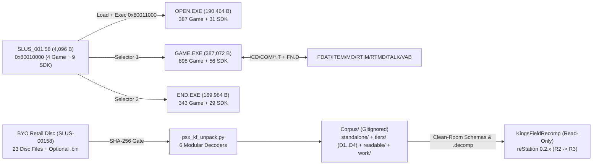
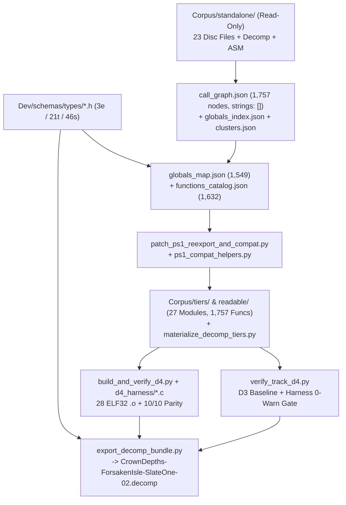

# CrownDepths ForsakenIsle (SlateOne) 02 Decomp — Architecture & Clean-Room System Map

**Version:** `0.2.0` (`2026-11-18`) · **Platform:** `ps1` (`SLUS-00158`) · **Pipeline:** `native_ghidra_c` · **ABI:** `ps1-mipsel` (`LP32`, `sizeof(long) == 4`)

---

## 1. System Context & Runtime Model

*King's Field* (North America `SLUS-00158`) executes on Sony PlayStation (R3000A little-endian MIPS32 + `COP2` GTE, `2 MiB` main RAM) via a tiny `4,096`-byte resident bootloader (`SLUS_001.58`) that chains three mutually exclusive child PS-X executables (`OPEN.EXE`, `GAME.EXE`, `END.EXE`) at fixed base **`0x80011000`**. This Tier R research container isolates copyrighted retail media inside gitignored `Corpus/` and publishes clean-room schemas, pure-stdlib decoders, a validated `.decomp` package (`CrownDepths-ForsakenIsle-SlateOne-02.decomp`), and technical manuals consumed strictly **read-only** by downstream `KingsFieldRecomp` (`reStation` `0.2.x`).

- **Resident Bootloader (`SLUS_001.58`):** `4,096` B (`0x800` PS-X EXE header + `0x800` / `2,048` B image at `0x80010000`, `pc0 = 0x80010128`). `kf_slus_crt0_start` zeroes `.bss` (`0x80010270..0x800102b3`), calls `InitHeap(&g_kf_boot_heap_base, 0x1e7d4c)`, and loops inside `kf_slus_main_exec_loop` (`0x80010038`) swapping `OPEN.EXE`, `GAME.EXE`, or `END.EXE` into `g_kf_boot_exec_hdr` (`0x80010274`).
- **Mutually Exclusive `0x80011000` Overlay Slot:** Because `OPEN.EXE` (`0x2e000` B), `GAME.EXE` (`0x5e000` B), and `END.EXE` (`0x29000` B) all share virtual base `0x80011000`, static analysis and `v0.3.0` rewrite metadata must key symbols by `(program, address)` rather than address alone.
- **Honest `D3` Decomp Baseline (`v0.2.0`):** [materialize_decomp_tiers.py](../scripts/materialize_decomp_tiers.py) preserves local `Corpus/tiers/{D1_Raw,D2_Structured,D3_Mapped,D4_CleanSource}` trees and coalesces all `259` chunks into `27` cohesive modules (`23` under `src/<subsystem>/` + `4` under `sdk/`) synced to `Corpus/readable/`. `Corpus/readable/` compiles into `28` ELF32 MIPS `.o` objects under `-Wno-everything` and passes `10/10` LP32 host parity checks, while `currentDecompTier` stays honestly at `"D3"` (`gates.D4.passed: false`, `d4ParityTier: "none"`) until `v0.3.0` resolves `583` `-Wall -Wextra` errors, `2,300` warnings, and `55,791` decompiler tells across all `1,757` functions and verifies `D4a` Subsystem Parity.

---

## 2. Binary, Overlay & Script Dependency Graph

| Layer / Boundary | Allowed Dependencies | Forbidden Dependencies (Hard Firewall) |
| :--- | :--- | :--- |
| **`Dev/scripts/` (Pure Stdlib)** | Python 3.12+ stdlib, `Dev/schemas/`, sibling `Dev/scripts/`, optional `--tools-dir` / `RD_DECOMP_TOOLS` / `ZIG_EXE` | External pip packages, hardcoded workstation paths, host production roots, `Corpus/` inside `.decomp` |
| **`Dev/scripts/d4_harness/`** | `kingsfield_types.h`, `kingsfield_globals.h`, coalesced `src/**/*.c` parity TUs | `kingsfield_functions.h` (avoids MinGW CRT `<string.h>` clashes), retail assets during `--offline-synthetic` |
| **`Dev/schemas/` & `Dev/docs/`** | Clean-room C type headers, neutral PS1 ABI comments, repo-relative Markdown links | Retail strings (`call_graph.json` `strings: []`), `.gpr`, `*.g.cs`, `*.Generated.dll`, vendor brand prose, local file-scheme URIs |
| **`KingsFieldRecomp`** | Published `Dev/schemas/`, `Dev/docs/`, and validated `.decomp` packages (read-only) | Direct writes into this repo, copying `Corpus/`, or bypassing BYO-disc checksum gates |

---

## 3. End-to-End Data Flows

1. **BYO-Disc Checksum Gate & Modular Container Unpack:** [psx_kf_unpack.py](../scripts/psx_kf_unpack.py) validates all `23` required `disc/files/*` entries (and optional `258,183,744`-byte raw `.bin`) using `1 MiB`-chunked SHA-256 hashing via [kf_t_archives.py](../scripts/kf_t_archives.py), failing closed with `MISSING_CORPUS_MEDIA` JSON when absent (`--offline-synthetic` creates synthetic fixtures inside `--data-dir`), and delegates across `6` domain decoders (`kf_t_archives.py`, `kf_world_fdat.py`, `kf_items_magic_talk.py`, `kf_meshes_mo_rtmd.py`, `kf_audio_vab_seq.py`, `kf_save_memcard.py`).
2. **Master Boot DB (`FDAT[48]`) & Zone Streaming:** `kf_game_mount_t_archives` (`0x80015dd4`) mounts all `7` `/CD/COM/*.T` slots, unpacks `FDAT[47]` (`503,808` B global VRAM pack) and `FDAT[48]` (`110,592` B, `9` length-prefixed tables incl. `KfMapObjDef[320]`, `KfMagicDef[18]`, `LevelUpGrowth[100]`, and `2` TMD banks), and hands off runtime zone loads (`0..7`, `10`) to `kf_game_step_area_load_fsm` (`0x8001689c`) and weapon view-model loads (`FDAT[49..66]`) to `kf_game_player_load_magic_def` (`0x80026210`).
3. **Stage 1–4 Indexing & Compatibility Lowering:** [call_graph.json](../schemas/call_graph.json) holds `1,757` nodes with all `111` embedded `"strings"` arrays cleared to `[]`; [globals_map.json](../schemas/globals_map.json) maps `1,549` LP32 globals (`292` `struct_member` across `13` roots); [functions_catalog.json](../schemas/functions_catalog.json) indexes `1,632` game functions; and [patch_ps1_reexport_and_compat.py](../scripts/patch_ps1_reexport_and_compat.py) + [ps1_compat_helpers.py](../scripts/ps1_compat_helpers.py) lower Ghidra subpieces, unaligned stack buffers, and multi-EXE duplicate SDK symbols into `Corpus/readable/`.
4. **Two-Pass Build, Modular Harness & Verifier Split:** [build_and_verify_d4.py](../scripts/build_and_verify_d4.py) compiles `27` cohesive `.c` modules + `globals_defs.c` into `28` ELF32 MIPS `.o` objects (`libkings_field_d4.a`, `1,588,042` B) and links the `5` matching `src/` parity modules + modular `d4_harness/*.c` (`-Wall -Wextra -Wno-unused-parameter`, `0` warnings) for `10/10` LP32 host parity (live or `--offline-synthetic` via [d4_synthetic_corpus.py](../scripts/d4_synthetic_corpus.py)), verified independently by [verify_track_d4.py](../scripts/verify_track_d4.py).
5. **Clean-Room `.decomp` Packaging:** [export_decomp_bundle.py](../scripts/export_decomp_bundle.py) reads [decomp_recipe.json](../schemas/decomp_recipe.json), packages `module.decomp.json` (`crowndepths-forsakenisle-slateone-02`, `reStation` `0.2.x`), clean-room `Dev/schemas/`, and `Dev/scripts/` into `CrownDepths-ForsakenIsle-SlateOne-02.decomp`, and validates every archive entry against `PsxCleanRoomValidator` rules.

---

## 4. File & Symbol Lookup Registry

| File Path | SLOC / Scope | Primary Exports / Role |
| :--- | :--- | :--- |
| [Dev/scripts/psx_kf_unpack.py](../scripts/psx_kf_unpack.py) | `<= 250` (`T0/T3`) | Disc SHA-256 gate, `--offline-synthetic`, unified unpacker across `6` decoders |
| [Dev/scripts/kf_t_archives.py](../scripts/kf_t_archives.py) | `<= 250` (`T3`) | `verify_required_disc_checksums`, `.T` sector table parser, `CD/FN.D`, `OP/*` |
| [Dev/scripts/kf_world_fdat.py](../scripts/kf_world_fdat.py) | `<= 250` (`T3`) | `FDAT.T` zones `0..7`+`10`, `FDAT[47]`, `FDAT[48]` `9`-section DB, `FDAT[49..66]` |
| [Dev/scripts/kf_items_magic_talk.py](../scripts/kf_items_magic_talk.py) | `<= 250` (`T3`) | `ITEM.T` (`548` slots), `TALK.T` (`755` slots), `KfItemDef` / `KfMagicDef` records |
| [Dev/scripts/kf_meshes_mo_rtmd.py](../scripts/kf_meshes_mo_rtmd.py) | `<= 250` (`T3`) | `MO.T` (`448` slots), `RTIM.T` (`75` slots), `RTMD.T` (`9` slots) decoders |
| [Dev/scripts/kf_audio_vab_seq.py](../scripts/kf_audio_vab_seq.py) | `<= 250` (`T3`) | `VAB.T` `.vh` `<IIIHHHHBBBBI` fix (`programs < 128`), `ProgAtr`/`VagAtr`, `pQES` `SEQ` |
| [Dev/scripts/kf_save_memcard.py](../scripts/kf_save_memcard.py) | `<= 250` (`T3`) | `BASLUS-00158` `KfSaveHeader` (`0x400` B), `0x3c00` checksum, `.mcr` scanner |
| [Dev/scripts/patch_ps1_reexport_and_compat.py](../scripts/patch_ps1_reexport_and_compat.py) | `211` (`<= 250`) | Pre-assembly P-code lowering, Stage 4 assembly, SDK dedupe, header patcher |
| [Dev/scripts/ps1_compat_helpers.py](../scripts/ps1_compat_helpers.py) | `226` (`<= 250`) | Span scanners, `._off_sz_` rewriter, `KF_PS1_COMPAT_EXTS` compat builder |
| [Dev/scripts/materialize_decomp_tiers.py](../scripts/materialize_decomp_tiers.py) | `<= 250` | Materializes `Corpus/tiers/{D1_Raw..D4_CleanSource}` and coalesces `27` D3 modules |
| [Dev/scripts/d4_synthetic_corpus.py](../scripts/d4_synthetic_corpus.py) | `<= 250` (`T1`) | Zero-disc synthetic `.T`/EXE/C fixtures for offline build & parity runs |
| [Dev/scripts/build_and_verify_d4.py](../scripts/build_and_verify_d4.py) | `<= 250` (`T1`) | Pass-1 `28` ELF32 MIPS build + Pass-2 globbed `d4_harness/*.c` `10/10` runner |
| [Dev/scripts/verify_track_d4.py](../scripts/verify_track_d4.py) | `<= 250` (`T1`) | Independent `D3` baseline + `0`-warn harness + ELF32 + SLOC + report verifier |
| [Dev/scripts/export_decomp_bundle.py](../scripts/export_decomp_bundle.py) | `<= 250` (`T2`) | Deterministic `.decomp` ZIP exporter & `PsxCleanRoomValidator` gate |
| `Dev/scripts/tests/test_kf_{parsers,decomp_cleanroom}.py` | `<= 250` (`T5`) | Isolated synthetic `unittest` suites (`0` retail media required) |
| `Dev/scripts/d4_harness/*.{c,h}` (`4` files) | `<= 250` / TU | `parity_harness.h`, `parity_abi_and_media_tests.c`, `parity_gameplay_and_str_tests.c`, `parity_runner_main.c` |

---

## 5. Schema & Data Ownership Map

| Schema / Header Artifact | Producer / Owner | Consumers | Canonical Standard 18 / Key Contract |
| :--- | :--- | :--- | :--- |
| [Dev/research.manifest.json](../research.manifest.json) | Stage gates + `v0.2.0` cutover | `decomp_cli.py`, `verify_track_d4.py` | `schemaVersion: 2`, `currentDecompTier: "D3"`, `d4ParityTier: "none"`, `currentRecompTier: "R2"`, `goalRecompTier: "R3"`, `currentPortTier: "none"`, `gates.D4.passed: false`, `engineId: "reStation"` |
| [standalone_integrity.json](../schemas/standalone_integrity.json) | `T0` retail disc gate | `psx_kf_unpack.py`, `decomp_cli.py` | `schemaVersion: 2`, `requiredDiscChecksums` (`23` disc files + optional `.bin`), zero `.gpr` |
| [call_graph.json](../schemas/call_graph.json), [globals_index.json](../schemas/globals_index.json), [clusters.json](../schemas/clusters.json) | Stage 1 indexer + `T0` scrub | Stage 2/3, `decomp_cli.py` | `1,757` nodes (`strings: []` across all `111` entries), `1,549` globals, `5` clusters, `waves 0..25` |
| [globals_map.json](../schemas/globals_map.json), [anchor_functions.json](../schemas/anchor_functions.json), [functions_catalog.json](../schemas/functions_catalog.json), `shards/*.json` | Stage 2/3 builders + `T0` scrub | `GhidraUniversalApplyAndExport.java` | `1,549` LP32 globals (`292` `struct_member`), `4` anchors + `1,628` sharded = `1,632` game funcs |
| [kingsfield_types.h](../schemas/kingsfield_types.h) + `Dev/schemas/types/*.h` (`4` headers) | Stage 2 curation + `T0` scrub | `d4_harness/`, `export_decomp_bundle.py` | `3` enums, `21` typedefs, `46` structs (`93` tracked sizes), neutral PS1 ABI comments |
| [d4_build_report.json](../schemas/d4_build_report.json), [s4_verify_report.json](../schemas/s4_verify_report.json), [spec_coverage.json](../schemas/spec_coverage.json) | `build_and_verify_d4.py`, `T0/T4` | `verify_track_d4.py`, `study_verifier.py` | `schemaVersion: 2`, `isPassed`, `unresolvedFieldCount: 0` (`96/96`), `craftsmanshipTellCount` |
| [decomp_recipe.json](../schemas/decomp_recipe.json), [decomp_local.example.json](../schemas/decomp_local.example.json) | `T2` recipe definition | `export_decomp_bundle.py`, `reStation` | `moduleId: "crowndepths-forsakenisle-slateone-02"`, `packageFileName`, `preloadRomDir: "data/rom"` |

---

## 6. Failure Modes & Resilience

| Failure Mode | Detection Point | Recovery / Fail-Closed Path |
| :--- | :--- | :--- |
| **`MISSING_CORPUS_MEDIA`** | Empty/missing `--data-dir` in `psx_kf_unpack.py`, decoders, `patch_ps1_reexport_and_compat.py`, `build_and_verify_d4.py` | Emits structured `{"status": "MISSING_CORPUS_MEDIA", ...}` JSON and exits non-zero without writing dummy outputs |
| **`> 64 MiB` SHA-256 Mismatch** | `verify_required_disc_checksums` (`kf_t_archives.py` / `psx_kf_unpack.py`) | Hashes `98,315,232`-B `OP/ED1.S` and `258,183,744`-B `.bin` in `1 MiB` chunks; fails closed on mismatch |
| **`VAB.T` `.vh` `programs=16511` Bug** | `kf_audio_vab_seq.py` (`VAB.T` parser) | Unpacks `VabHdr` after `pBAV` with `<IIIHHHHBBBBI` (`programs=2, tones=23, vags=22` on `VAB.T[0]`) |
| **`0x80011000` Multi-EXE Collision** | `OPEN.EXE`, `GAME.EXE`, `END.EXE` share base `0x80011000` | `dedupe_sdk_files` isolates duplicate SDK definitions now; `v0.3.0` shards key functions by `(program, address)` |
| **Hidden `-Wno-everything` Masking** | `verify_track_d4.py` + `0.1.0-hf.1` `@inspecter` recon | `v0.2.0` reports `currentDecompTier: "D3"` honestly (`583` err / `2,300` warn / `55,123` tells) until `v0.3.0` rewrite |
| **MinGW `<string.h>` Prototype Clash** | Pass 2 `x86-windows-gnu` linking in `build_and_verify_d4.py` | Omits `kingsfield_functions.h` from `d4_harness/` and filters `LIBC_SYMS` out of generated `host_stubs.c` |

---

## 7. Security & Clean-Room Model

- **Three-Layer Containment:** `Corpus/`, `Archive/`, `Dev/data/`, `Dev/logs/`, `*.tmp.decomp`, and `Dev/docs/{plans,reports}/` are excluded via `.gitignore` and `-xr!Corpus -xr!Corpus\*` in `.7z` archives; `Corpus/standalone/` enforces `IsReadOnly = true`.
- **Zero Retail Media / Secrets ([SECURITY.md](../../SECURITY.md)):** No retail binaries, `.tim`/`.vab`/`.seq`/`.s` assets, BIOS dumps, `.gpr` databases, `*.g.cs`, `*.Generated.dll`, vendor SDK brands, workstation paths, local file-scheme URIs, or secrets appear in Git or `.decomp` exports; live Notion IDs live solely in gitignored `Dev/data/notion_hub.local.json`.
- **Scrubbed Metadata & Pure Stdlib:** `call_graph.json` emits `"strings": []` on all `111` previously populated functions; Python tools use stdlib only with zero `shell=True`, `eval`, or external pip packages; `export_decomp_bundle.py --verify-cleanroom` validates every bundle entry.

---

## 8. Testing & Verification Strategy Map

| Suite / Command | Scope Covered | Runtime Mode | Known Boundary / Notes |
| :--- | :--- | :--- | :--- |
| `python -B -m unittest discover -s Dev/scripts/tests -v` | All `6` decoders + `psx_kf_unpack.py`, `VAB.T` `.vh`, `spec_coverage` (`96/96`), cleanroom `.decomp` | Isolated `%TEMP%` | Zero retail media or `Corpus/` writes required |
| `python -B Dev/scripts/psx_kf_unpack.py --offline-synthetic` | Synthetic `.T` / `FN.D` / `OP` extraction + empty `--data-dir` `MISSING_CORPUS_MEDIA` check | `--offline-synthetic` or live | Full `23`-file + `.bin` SHA-256 enforced in live mode |
| `python -B Dev/scripts/build_and_verify_d4.py` | Pass 1 `27` `.c` + `globals_defs.c` (`28` ELF32 `.o`) + Pass 2 `d4_harness/*.c` (`10/10`) | `--offline-synthetic` or live | Requires `zig` (`ZIG_EXE`, `PATH`, or `%LOCALAPPDATA%`) |
| `python -B Dev/scripts/verify_track_d4.py` | `D3` baseline + `Corpus/tiers/` + `0`-warn `d4_harness/*.c` + `28` ELF32 `.o` + SLOC | `--offline-synthetic` or live | Reports `craftsmanshipTellCount` (`55791` live / `0` synth) |
| `python -B Dev/scripts/export_decomp_bundle.py --verify-cleanroom` | Emits `CrownDepths-ForsakenIsle-SlateOne-02.decomp` + runs `PsxCleanRoomValidator` checks | Pure stdlib | Targets `reStation` `0.2.x`; `reSlate` cutover in `v0.3.0` |
| `decomp_cli.py verify --tier D3` / `--tier S4` | Upstream universal `R&D` `D0..D3`, `S0..S4`, and Tier R 3-folder hygiene | Research CLI (`--no-clangd`) | External `R&D` tools read-only via `RD_DECOMP_TOOLS` |

---

## 9. Design Decisions Log (ADRs)

- **ADR-001 · 2026-11-14 · `v0.1.0` — `SLUS_001.58` Trampoline & Fixed `0x80011000` Child Base:** *Context:* `OPEN.EXE`, `GAME.EXE`, and `END.EXE` all assemble at `0x80011000`. *Decision:* Analyze all `4` EXEs independently in Stage 1–3 schemas and deduplicate shared SDK routines during Stage 4 assembly. *Consequences:* Clean `260`-object MIPS build (`v0.1.0`), motivating `(program, address)` shards in `v0.3.0`.
- **ADR-002 · 2026-11-18 · `v0.2.0` — Honest `D3` Baseline Re-Opening (`gates.D4.passed: false`):** *Context:* Stripping `-Wno-everything` and `17` `.clangd` suppressions revealed `583` errors, `2,300` warnings, and `55,123` decompiler tells across `259` fragments. *Decision:* Re-open `currentDecompTier` to `"D3"` while keeping the `260`-object MIPS + `10/10` modular `d4_harness/` active and gating `-Wall -Wextra` `0`-warn `D4_CleanSource` (`D4a` Subsystem Parity) on `v0.3.0`. *Consequences:* Accurate tier reporting without halting `reStation` `0.2.x` `.decomp` progress.
- **ADR-003 · 2026-11-18 · `v0.2.0` — Clean-Room Scrub & `SeriesMap` `.decomp` Identity:** *Context:* `call_graph.json` embedded `111` retail string lists, `standalone_integrity.json` hashed `0`-B `.gpr`, and root docs contained workstation paths/UUIDs. *Decision:* Strip all `111` `strings` arrays, upgrade `standalone_integrity.json` to `23` disc files (`> 64 MiB` chunked SHA-256), neutralize vendor SDK brands, adopt `CrownDepths-ForsakenIsle-SlateOne-02.decomp`, and isolate Notion IDs into gitignored `Dev/data/notion_hub.local.json`. *Consequences:* Public-ready clean-room tree ahead of gated history filtering.
- **ADR-004 · 2026-11-18 · `v0.2.0` — Six Modular Decoders & `VAB.T` `.vh` `<IIIHHHHBBBBI` Fix:** *Context:* Legacy `psx_kf_unpack.py` unpacked `.vh` with `<IIIIIIHHH` (`programs=16511`) and omitted deep `FDAT[48]`, `MO.T`, `RTMD.T`, `RTIM.T`, `TALK.T`, and save decoders. *Decision:* Split decoders into `6` pure-stdlib `<= 250`-SLOC modules aligned 1:1 with `6` `150–380`-line spec spokes (`96/96` fields). *Consequences:* Complete container/DB decoding verified offline by `unittest`.

---

## 10. Zero-Touch Extension Playbooks

1. **Add a Specification Spoke & Modular Decoder:** Author `Dev/docs/specifications/<topic>.md` (`150–380` lines), add or extend a pure-stdlib `<= 250`-SLOC module under `Dev/scripts/kf_<topic>.py` supporting `--data-dir`, `--log-dir`, `--offline-synthetic`, and `MISSING_CORPUS_MEDIA`, add synthetic tests in `Dev/scripts/tests/`, and update [spec_coverage.json](../schemas/spec_coverage.json) and [SPECIFICATIONS.md](SPECIFICATIONS.md).
2. **Add a Pass-2 LP32 Host Parity TU:** Create `Dev/scripts/d4_harness/<suite>.c` (`<= 250` code-only SLOC, `-Wall -Wextra -Wno-unused-parameter` `0` warnings), declare and invoke it from [parity_harness.h](../scripts/d4_harness/parity_harness.h) and [parity_runner_main.c](../scripts/d4_harness/parity_runner_main.c) (Pass-2 globbing compiles all `d4_harness/*.c` automatically), and add synthetic corpus seeds in [d4_synthetic_corpus.py](../scripts/d4_synthetic_corpus.py).
3. **Prepare `v0.3.0` `(program, address)` Clean C Shards:** Populate `Dev/schemas/d4_rewrites/*.json` keyed by `(program, address)` (preserving zero C function bodies or retail strings in tracked metadata) while keeping `Corpus/tiers/{D1_Raw,D2_Structured,D3_Mapped,D4_CleanSource}/` strictly local and gitignored.
