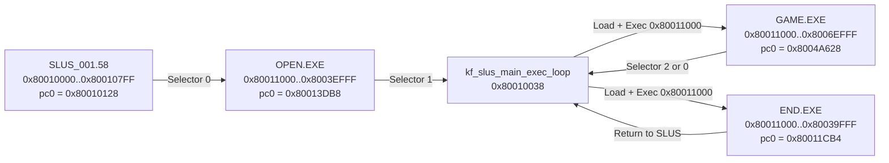

# 4-EXE Trampoline Boot & Main RAM Memory Map (`SLUS-00158`)

**Findings ID:** `four-exe-trampoline-and-ram-layout` · **Parent Hub:** [Dev/docs/FINDINGS.md](../FINDINGS.md) · **Architecture:** [Dev/docs/ARCHITECTURE.md](../ARCHITECTURE.md) · **Parity Suite:** [parity_abi_and_media_tests.c](../../scripts/d4_harness/parity_abi_and_media_tests.c)

This empirical report documents the Sony PlayStation (`SLUS-00158`) multi-executable trampoline boot topology, exact `PS-X EXE` headers verified across all `4` disc executables, shared **`0x80011000`** overlay RAM occupancy, anchored `LP32` runtime tables in `GAME.EXE`, and topological call-graph stratification.

---

## 1. Resident Bootloader (`SLUS_001.58`) & Trampoline Mechanics

Unlike monolithic PlayStation 1 titles or dual-slot overlay engines that keep gameplay or rendering permanently resident above `0x80010000`, *King's Field* (`SLUS-00158`) dedicates **`SLUS_001.58`** (`4,096` bytes total: `0x800` PS-X EXE header + `0x800` / `2,048`-byte image) exclusively to hardware initialization and executable switching (`0x80010000..0x800107FF`).



### Verified Boot & Handoff Sequence (`src/core/core_01.c`, `OPEN.EXE`, `GAME.EXE`)

1. **`kf_slus_crt0_start` (`0x80010128`):** SN Systems `crt0` startup zeroes resident `.bss` (`&g_kf_crt0_saved_ra` `0x80010270` through `0x800102b3`), preserves the BIOS return address in `g_kf_crt0_saved_ra`, invokes `InitHeap((ulong *)&g_kf_boot_heap_base, 0x1e7d4c)` starting at **`0x800102b8`** (covering `~1.90 MiB` up to `0x801f8004`), and enters `kf_slus_main_exec_loop()`.
2. **`kf_slus_main_exec_loop` (`0x80010038`):** Calls `__main()`, `SetMem(2)` (configuring `2 MiB` RAM mode), `kf_slus_bios_96_remove()` (`0x80010244`, BIOS `A0h:72h`), and `_96_init()`, initializes `g_kf_boot_next_exe_selector = 0` (`0x800102f0`) and `g_kf_boot_intro_seen_flag = 0` (`0x800102f8`), and loops:
   - Retries `Load(cdrom_paths[g_kf_boot_exe_index], &g_kf_boot_exec_hdr)` until `Load(...) == 1`.
   - Calls `kf_slus_bios_96_remove()` to tear down the resident ISO-9660 handler cleanly before child execution.
   - Clears `g_kf_boot_exec_hdr_s_addr` (`0x80010294`) and `g_kf_boot_exec_hdr_s_size` (`0x80010298`).
   - Enters critical section via `kf_slus_enter_critical_section()` (`0x800101e4`, `syscall(0)`) and invokes `Exec(&g_kf_boot_exec_hdr, 0, NULL)`.
   - When the child executable returns, copies `(uint)g_kf_boot_next_exe_selector` into `g_kf_boot_exe_index` (`0x80010268`) and re-initializes ISO-9660 with `_96_init()`.
3. **Verified Selector Write Sites Across Child EXEs:**
   - **`OPEN.EXE` (`open_52.c`):** Checks `if (g_kf_boot_intro_seen_flag == '\x01')` to bypass the opening cinema on title revisit, and writes `g_kf_boot_next_exe_selector = 1` (`KF_EXE_GAME`) when starting a new game or loading from Memory Card.
   - **`GAME.EXE` (`game_157.c`):** Writes `g_kf_boot_next_exe_selector = 2` (`KF_EXE_END`) upon triggering the ending, or writes `g_kf_boot_next_exe_selector = 0` (`KF_EXE_OPEN`) paired with `g_kf_boot_intro_seen_flag = 1` when exiting back to the title menu.

```c
/* Clean-room behavioral summary of kf_slus_main_exec_loop (0x80010038) */
g_kf_boot_next_exe_selector = 0; /* 0x800102f0 */
g_kf_boot_intro_seen_flag = 0;   /* 0x800102f8 */
for (;;) {
    while (Load(cdrom_paths[g_kf_boot_exe_index], &g_kf_boot_exec_hdr) != 1) {}
    kf_slus_bios_96_remove();
    g_kf_boot_exec_hdr_s_addr = 0;
    g_kf_boot_exec_hdr_s_size = 0;
    kf_slus_enter_critical_section();
    Exec(&g_kf_boot_exec_hdr, 0, NULL);
    g_kf_boot_exe_index = (uint)g_kf_boot_next_exe_selector;
    _96_init();
}
```

### Pre-`.text` CD-ROM Path Table & Resident Boot Globals (`SLUS_001.58`)

| Virtual Address | Symbol / Literal | Size | Verified Role in `SLUS_001.58` |
| :--- | :--- | ---: | :--- |
| `0x80010000` | `"cdrom:END.EXE;1"` | `16` B | Selector `KF_EXE_END` (`2`) child disc image path |
| `0x80010010` | `"cdrom:GAME.EXE;1"` | `17` B | Selector `KF_EXE_GAME` (`1`) child disc image path |
| `0x80010024` | `"cdrom:OPEN.EXE;1"` | `17` B | Selector `KF_EXE_OPEN` (`0`) child disc image path |
| `0x80010268` | `g_kf_boot_exe_index` | `4` B | Active `KfExeSelector` index (`0=OPEN`, `1=GAME`, `2=END`) |
| `0x80010270` | `g_kf_crt0_saved_ra` | `4` B | Saved BIOS return link register |
| `0x80010274` | `g_kf_boot_exec_hdr` (`EXEC`) | `60` B | PS-X `EXEC` struct (`+0x20 s_addr`, `+0x24 s_size`) |
| `0x800102b8` | `g_kf_boot_heap_base` | `4` B | Main heap base passed to `InitHeap(..., 0x1e7d4c)` |
| `0x800102f0` | `g_kf_boot_next_exe_selector` | `1` B | Next `KfExeSelector` written by child before returning |
| `0x800102f8` | `g_kf_boot_intro_seen_flag` | `1` B | Tracks whether opening intro sequence has played |

---

## 2. Verified `PS-X EXE` Header Geometry Across All `4` Binaries

Every executable in `Corpus/standalone/disc/files/` opens with the standard 8-byte `"PS-X EXE"` signature, zero `gp0`, initial stack pointer `s_addr = 0x801ffff0`, and North America license region string (`"Sony Computer Entertainment Inc. for North America area"`):

| Executable | Total Bytes | `t_addr` | `t_size` (Hex / Bytes) | `pc0` (Entry) | Game Funcs | SDK Funcs | GTE Funcs |
| :--- | ---: | :--- | :--- | :--- | ---: | ---: | ---: |
| `SLUS_001.58` | `4,096` | `0x80010000` | `0x800` (`2,048` B) | `0x80010128` | `4` | `9` | `0` |
| `OPEN.EXE` | `190,464` | `0x80011000` | `0x2e000` (`188,416` B) | `0x80013db8` | `387` | `31` | `10` |
| `GAME.EXE` | `387,072` | `0x80011000` | `0x5e000` (`385,024` B) | `0x8004a628` | `898` | `56` | `37` |
| `END.EXE` | `169,984` | `0x80011000` | `0x29000` (`167,936` B) | `0x80011cb4` | `343` | `29` | `10` |
| **Total** | **`751,616`** | — | **`743,424` B payload** | — | **`1,632`** | **`125`** | **`57`** |

- **Entry Thunks:** `OPEN.EXE` jumps from `kf_open_entry_point` (`0x80013db8`) into `kf_open_main` (`0x80011ae0`, wave `11`); `GAME.EXE` jumps from `kf_game_entry_boot` (`0x8004a628`, wave `25`) into `kf_game_main_loop` (`0x8001369c`, wave `23`); and `END.EXE` jumps from `kf_end_entry_point` (`0x80011cb4`) into `kf_end_main` (`0x800119a4`, wave `10`).
- **Mutual Exclusion vs. Static Collision at `0x80011000`:** On real PlayStation hardware, only one of `OPEN.EXE`, `GAME.EXE`, or `END.EXE` occupies `0x80011000+` at any instant (`SLUS_001.58` persists below `0x80010800`). However, static decompilation indexes all three overlays side-by-side, producing exact virtual-address overlaps across `.text` (e.g., `OPEN.EXE` `0x80011000..0x8003efff`, `GAME.EXE` `0x80011000..0x8006efff`, `END.EXE` `0x80011000..0x80039fff`) and `59` duplicated PS1 SDK runtime symbols across `sdk_01..sdk_05.c`.

---

## 3. Main RAM Layout & `GAME.EXE` Anchored Data Structures

Across `Dev/schemas/globals_map.json`, `1,549` global symbols (`310` high confidence, `1,239` medium confidence) partition across `GAME.EXE` (`914`: `624` standalone + `290` `struct_member`), `OPEN.EXE` (`324`), `END.EXE` (`297`), and resident `SLUS_001.58` (`14`: `12` standalone + `2` `struct_member`). Thirteen anchored parent structs organize `292` field-level globals:

| RAM Base Address | Global Symbol & Type | Size (B) | Members | Primary Role in Runtime Architecture |
| :--- | :--- | ---: | ---: | :--- |
| `0x80010274` | `g_kf_boot_exec_hdr` (`EXEC`) | `60` | `2` | `SLUS_001.58` overlay `Load`/`Exec` descriptor |
| `0x800679a0` | `g_kf_game_ro_table_base_800679a0` | `2,816` | — | `FDAT[48]` Section 5 boot-loaded static lookup table |
| `0x8007682c` | `g_kf_game_bss_u16_8007682c` | `1,200` | — | `FDAT[48]` Section 3 `LevelUpGrowth[100]` (`12` B/lvl) |
| `0x800864e4` | `g_kf_game_bss_table_base_800864e4` | `83,540` | — | `FDAT[48]` Section 8 TMD pack mounted at dynamic slot `0x28` |
| `0x800fb014` | `g_kf_game_bss_table_base_800fb014` | `6,280` | — | `FDAT[48]` Section 7 TMD pack mounted at dynamic slot `0x00` |
| `0x80100000` | `g_kf_fmv_stream_buffer_base` | — | — | High-buffer ring region for `OP*.S` / `ED*.S` MDEC frames |
| `0x8016c544` | `g_kf_entity_table[200]` (`KfEntityState`) | `24,800` | `19` | `200` active monster/NPC slots (`0x7c` B stride) |
| `0x80172624` | `g_kf_entity_def_table[40]` (`KfEntityDef`) | `4,800` | `25` | `40` monster/NPC archetype definitions (`0x78` B stride) |
| `0x80175914` | `g_kf_map_obj_def_table[320]` (`KfMapObjDef`) | `7,680` | `16` | `FDAT[48]` Section 0 interactive object templates (`0x18` B stride) |
| `0x80177714` | `g_kf_map_obj_table[396]` (`KfMapObjState`) | `27,024` | `23` | `396` active world object instances (`0x44` B stride) |
| `0x8017e05c` | `g_kf_scene_control` (`KfSceneControl`) | `28` | `19` | Multi-phase zone load FSM (`kf_game_step_area_load_fsm`) |
| `0x8018e0ac` | `g_kf_gfx_env` (`KfGfxEnv`) | `224` | `15` | Double-buffered PS1 `DRAWENV[2]` + `DISPENV[2]` (`0xe0` B) |
| `0x80192d58` | `g_kf_tex_anim_slots[8]` (`KfTextureAnimSlot`) | `192` | `1` | `8` animated VRAM texture scroll descriptors (`0x18` B stride) |
| `0x80192e78` | `g_kf_camera_state` (`KfCameraState`) | `52` | `13` | First-person camera position, pitch/yaw/roll & grid origin |
| `0x80195174` | `g_kf_world_drop_table[128]` (`KfWorldDrop`) | `3,072` | `1` | `128` ground item pickups (`0x18` B stride) |
| `0x801989d8` | `g_kf_game_bss_s16_801989d8` | `2,560` | — | `FDAT[48]` Section 6 resident table |
| `0x80199414` | `g_kf_player_state` (`KfPlayerState`) | `352` | `148` | Complete `0x160`-B player XP/HP/MP/equipment/kinematics |
| `0x8019c5ec` | `g_kf_game_bss_table_base_8019c5ec` | `1,664` | — | `FDAT[48]` Section 4 resident table |
| `0x801b3188` | Zone-delta persistent heap arena | — | — | Relocated by `kf_game_save_{unpack,pack}_zone_offsets` |
| `0x801b6fa8` | `g_kf_fdat_load_hdr` (`KfFdatHeader`) | `4` | — | Staging header (`+0x08` payload at `0x801b6fb0`) for `FDAT` loads |
| `0x801c7fbc` | `g_kf_magic_def_table[18]` (`KfMagicDef`) | `1,224` | `8` | `FDAT[48]` Section 1 (`+8`-B trailer = `1,232` B) spell/weapon table |
| `0x801c8484` | `g_kf_map_cells[6400]` (`KfMapCell`) | `64,000` | `2` | `80x80` dual-layer floor/ceiling dungeon grid (`10` B/cell) |
| `0x801d9a2c` | `KfItemDef` defense/item modifier table | `>= 512` | — | Accessed at `+0x02..+0x12` (`pdef`, `mdef`, elemental resists) |
| `0x801d9ccc` | `g_kf_game_bss_table_base_801d9ccc` | `2,048` | — | `FDAT[48]` Section 2 (`64 * 0x20` B) resident equipment/item table |

- **Hardware Register Regions:** `globals_map.json` maps `449` `CODE`, `1,099` `RAM`, and `1` `SPU_VOICES` entry (`0x1f801c0a`, `g_kf_spu_voice0_adsr_hi`), alongside `0x80000200` (`g_kf_bios_warm_data_buf`) and `0x80001000` (`g_kf_low_ram_scratch_word`).

---

## 4. Call Graph Stratification, Fan-In Hubs & Clean-Room Scrub (`v0.2.0`)

Static analysis across `Dev/schemas/call_graph.json`, `clusters.json`, and `functions_catalog.json` establishes `100%` function coverage (`0` `DECOMPILE FAILED` markers across all `1,757` functions):

### Top Fan-In Functions Across `call_graph.json` & `functions_catalog.json`

| Binary & Address | Catalog Symbol (`functions_catalog.json`) | Callers | Wave | Domain / SDK |
| :--- | :--- | ---: | ---: | :--- |
| `OPEN.EXE@80014c0c` | `printf` | `36` | `0` | `sdk` (Formatted debug/log output) |
| `GAME.EXE@80060194` | `printf` | `32` | `0` | `sdk` (Formatted debug/log output) |
| `END.EXE@80012914` | `printf` | `30` | `0` | `sdk` (Formatted debug/log output) |
| `GAME.EXE@80022530` | `kf_game_ui_begin_ot_frame` | `29` | `4` | `ui_hud` (Flips UI double-buffer OT frame) |
| `GAME.EXE@800226a8` | `kf_game_ui_flush_ot_frame` | `29` | `7` | `ui_hud` (Submits UI OT + `DrawSync`/`VSync`) |
| `GAME.EXE@80022efc` | `kf_game_pad_wait_release` | `28` | `1` | `input_save` (Wait until controller buttons release) |
| `GAME.EXE@80022dc4` | `kf_game_ui_play_menu_sfx` | `26` | `15` | `ui_hud` (Maps UI actions to sound effects) |
| `GAME.EXE@800601e4` | `rand` | `24` | `0` | `sdk` (PRNG shared across combat/drops/FX) |
| `GAME.EXE@8005eb08` | `kf_game_math_rsin` | `19` | `1` | `core` (`Q12` fixed-point sine lookup) |
| `GAME.EXE@80015394` | `kf_game_math_ratan2` | `18` | `1` | `core` (`12`-bit integer CORDIC arctangent) |

### Topological Stratification & Clean-Room Requirements

- **Topological Waves (`0..25`) & Audio SEQ SCCs:** Bottom-up condensation places leaf helpers and `125` SDK functions at wave `0`, overlay main loops at waves `10..11` (`kf_end_main` `w10`, `kf_open_main` `w11`), and `kf_game_entry_boot` at wave `25`. Exactly two non-trivial 4-node SCCs exist—both in duplicate sound sequence handlers: `END.EXE@{80012a84, 80012b90, 80012cc0, 80012ed8}` and `OPEN.EXE@{80014d7c, 80014e88, 80014fb8, 800151d0}`.
- **Embedded String Scrub (`v0.2.0` `T0`):** Earlier Stage 1 exports stored retail ASCII string literals inside `111` of `1,757` nodes in `call_graph.json` (`meta.strings_json_counts`: `SLUS_001.58: 3`, `OPEN.EXE: 118`, `GAME.EXE: 117`, `END.EXE: 101`). In `v0.2.0`, all `111` `"strings"` arrays are cleared to `[]` while preserving call edges and `meta` statistics so `call_graph.json` ships safely in `.decomp` bundles and public Git.
- **`v0.3.0` `(program, address)` Keying Requirement:** Because `OPEN.EXE`, `GAME.EXE`, and `END.EXE` all map to `0x80011000`, `v0.3.0` rewrite shards under `Dev/schemas/d4_rewrites/` must key every symbol override by `(program, address)` rather than hex address alone.

### Stage 1 Clusters vs. Stage 3 Functional Domains (`1,757` Functions)

| Cluster (`clusters.json`) / Domain (`functions_catalog.json`) | Funcs | C Lines | Covered Executable(s) & Subsystem Scope |
| :--- | ---: | ---: | :--- |
| `core` (`SLUS_001.58` + `GAME.EXE`) | `119` | — | `4` resident bootloader + `115` `GAME.EXE` mainloop, math & heap |
| `module_open` (`OPEN.EXE`) | `387` | `14,327` | Title screen, `OP*.S` playback, new-game & Memory Card load flow |
| `module_game` (`GAME.EXE` core state) | `202` | — | Dungeon state machine, combat math, AI, triggers & scene control |
| `audio` (`GAME.EXE`) | `191` | — | SPU voice management, `VAB` soundbanks & `SEQ` music playback |
| `render_gfx` (`GAME.EXE`) | `190` | — | PS1 GPU ordering tables (`OT`), `COP2` transforms, `MO` morphing & VRAM |
| `io_storage` (`GAME.EXE`) | `90` | — | CD-ROM streaming, `/CD/COM/*.T` slot table mount & async queue |
| `ui_hud` (`GAME.EXE`) | `82` | — | Gauges, inventory/equip screens, dialogue cards & compass HUD |
| `input_save` (`GAME.EXE`) | `28` | — | Controller polling & `BASLUS-00158` Memory Card save serialization |
| `module_end` (`END.EXE`) | `343` | `11,738` | Ending credits & `320x240` (`0x140 x 0xf0`) STR/MDEC decoder |
| `sdk` (All `4` Executables) | `125` | `1,873` | PS1 SDK & CRT runtime (`9` `SLUS`, `31` `OPEN`, `56` `GAME`, `29` `END`) |

### `kf_slus_crt0_start` (`0x80010128`) Resident Startup Layout

```c
/* Clean-room summary of SLUS_001.58 crt0 entry (0x80010128) */
for (u32 *bss = &g_kf_crt0_saved_ra; bss < (u32 *)0x800102b4; ++bss) {
    *bss = 0;
}
g_kf_crt0_saved_ra = bios_return_addr;
InitHeap((ulong *)&g_kf_boot_heap_base, 0x1e7d4c);
kf_slus_main_exec_loop();
```
