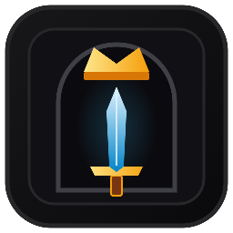

<div align="center">



# CrownDepths ForsakenIsle (SlateOne) 02 Decomp

Clean-room MIPS32 decompilation research, binary format specifications, and portable `.decomp` package for `SLUS-00158`.

   -lightgrey?style=flat)

**Decompilation Progress:** `▓▓▓░░░░░░░` **35%** — Mapped `1,757`-function C baseline, full `23`-file disc gate, `6` modular decoders, `96/96` spec fields, and `.decomp` bundle; cohesive zero-warning C rewrite next

</div>

---

## About

> **Beta (Pre-1.0):** *CrownDepths ForsakenIsle (SlateOne) 02 Decomp* (`v0.2.0`) is an active pre-1.0 clean-room research beta targeting `v1.0.0` reference certification and `v2.0.0` byte-exact matching.

This repository documents the binary internals of North American `SLUS-00158` (*CrownDepths ForsakenIsle / SlateOne 02*) using strictly clean-room reverse engineering. It turns raw MIPS32 executables and `/CD/COM/*.T` containers into indexed schemas, typed C headers, modular Python decoders, and documented format specifications—without distributing any copyrighted game code or assets.

The clean-room output is packaged into a self-contained `.decomp` bundle (`CrownDepths-ForsakenIsle-SlateOne-02.decomp`) targeting the `reStation` (`0.2.x`) static recompilation engine and compatible downstream recompilation projects.

## Key Features

- **4-Executable Indexing & Typed ABI Headers:** Maps `1,757` functions (`1,632` game + `125` runtime SDK) and `1,549` globals across `SLUS_001.58`, `OPEN.EXE`, `GAME.EXE`, and `END.EXE`, backed by `46` verified LP32 structs, `21` typedefs, and `3` enums.
- **Full Disc Gate & 6 Modular Decoders:** Validates all `23` extracted retail disc files (plus optional `258,183,744`-byte `.bin`) via chunked SHA-256 checksums before decoding `FDAT.T` (including the `FDAT[48]` master boot database), `ITEM.T`, `MO.T`, `RTIM.T`, `RTMD.T`, `TALK.T`, `VAB.T` (`.vh`/`.vb`/`.seq`), `CD/FN.D`, `OP/*`, and `BASLUS-00158` saves.
- **MIPS ELF32 Build & Modular Host Parity:** Organizes all `1,757` functions into `27` cohesive C domain and runtime SDK modules (while preserving raw and structured snapshots locally), compiles `28` ELF32 MIPS objects (`libkings_field_d4.a`), and runs `10` deterministic `x86-windows-gnu` LP32 host parity checks with zero warnings across `Dev/scripts/d4_harness/`.
- **Offline Synthetic Testing & `.decomp` Packaging:** Executes unit tests, parity builds, and clean-room `.decomp` validation without requiring retail disc media.

## Getting Started

### Prerequisites

- **Python 3.12+** on your `PATH`
- *Optional:* `zig` and `clangd` if you want to compile ELF32 MIPS objects or inspect C headers locally

### Releases & Downloads

Every release is published on both [GitHub Releases](https://github.com/StreamResearch/CrownDepths-ForsakenIsle-SlateOne-02-Decomp/releases) and the [Google Drive Releases Mirror](https://drive.google.com/drive/folders/12OXcn1JTLc2MSrIypouirI-xwa5hUn4d):

- **`CrownDepths-ForsakenIsle-SlateOne-02.decomp`** — Clean-room `.decomp` package (`41` entries) for `reStation` (`0.2.x`).
- **`CrownDepths-ForsakenIsle-SlateOne-02-Decomp-v0.2.0.zip`** — Portable clean-room research bundle (schemas, headers, Python decoders, parity harness, and manuals).

### Quick Try (No Disc Required)

Clone the repository and run the synthetic unit tests to verify your environment:

```powershell
git clone https://github.com/StreamResearch/CrownDepths-ForsakenIsle-SlateOne-02-Decomp.git
cd CrownDepths-ForsakenIsle-SlateOne-02-Decomp
python -B -m unittest discover -s Dev/scripts/tests -v
```

### Unpacking Your Own Disc Copy

If you own a legal North American `SLUS-00158` disc image, point the unpacker at your extracted game directory:

```powershell
python -B Dev/scripts/psx_kf_unpack.py --data-dir "<path-to-your-disc-files>" --out-dir Corpus/work/extracts/assets --log-dir Dev/logs
```

> Missing or empty `--data-dir` paths fail closed and exit non-zero without touching disk.

<details>
<summary>Full verification and developer scripts</summary>

```powershell
# Offline synthetic unpack, multi-tier materializer, MIPS build, parity harness, and verifier
python -B Dev/scripts/psx_kf_unpack.py --offline-synthetic --data-dir "$env:TEMP\kf-unpack" --log-dir Dev/logs
python -B Dev/scripts/materialize_decomp_tiers.py --offline-synthetic --data-dir "$env:TEMP\kf-tiers" --log-dir Dev/logs
python -B Dev/scripts/build_and_verify_d4.py --offline-synthetic --data-dir "$env:TEMP\kf-d4" --log-dir Dev/logs
python -B Dev/scripts/verify_track_d4.py --offline-synthetic --data-dir "$env:TEMP\kf-d4" --log-dir Dev/logs

# Export and validate the clean-room .decomp package
python -B Dev/scripts/export_decomp_bundle.py --verify-cleanroom --log-dir Dev/logs
```

</details>

## Project Structure

- `Dev/` — Pure-stdlib Python decoders, parity harness, C headers, schemas, and technical manuals
- `Corpus/` — Local working directory for your own disc files and generated C builds (gitignored; never committed)
- `Archive/` — Compressed clean-room source snapshots
- `CrownDepths-ForsakenIsle-SlateOne-02.decomp` — Tracked clean-room package consumed by `reStation`

## Documentation

- [Features](FEATURES.md) — Current capabilities and module index
- [Roadmap](ROADMAP.md) — Active goals and upcoming milestones
- [Changelog](CHANGELOG.md) — Release history
- [Contributing](CONTRIBUTING.md) — How to report issues, run tests, and submit changes
- [Architecture](Dev/docs/ARCHITECTURE.md) — Boot trampoline, executable layout, and system map
- [Specifications](Dev/docs/SPECIFICATIONS.md) — Binary formats (`96/96` mapped fields) and clean-room C types
- [Findings](Dev/docs/FINDINGS.md) — Empirical discoveries on `FDAT[48]`, `.T` packs, `VAB.T`, and LP32 ABI
- [Operations](Dev/docs/OPERATIONS.md) — CLI workflows, synthetic checks, and bundle export

## License & Legal

Distributed under the **MIT License** ([LICENSE](LICENSE)) for all clean-room Python tooling, JSON schemas, C headers, and documentation in this repository. See [SECURITY.md](SECURITY.md) for clean-room boundaries and vulnerability reporting.

**No Copyrighted Assets:** This repository contains zero game binaries, disc images, audio, textures, console BIOS files, or `.gpr` databases. You must supply your own legally obtained North American `SLUS-00158` disc copy.

*King's Field* is a registered trademark of FromSoftware, Inc. *PlayStation* is a registered trademark of Sony Interactive Entertainment Inc. This independent clean-room research project is not affiliated with, endorsed by, or connected to FromSoftware, Inc. or Sony Interactive Entertainment Inc.
