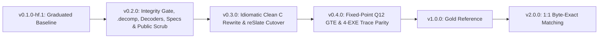

# Roadmap

Current baseline: **v0.2.0 (Beta)** | Active target: **v0.3.0** | See [CHANGELOG.md](CHANGELOG.md) for detailed release notes.

## Vision

- **v1.0.0 (Gold Reference):** Certify *CrownDepths ForsakenIsle (SlateOne) 02 Decomp* (`SLUS-00158`) as a self-contained clean-room reference repository featuring verified container decoders, complete binary format specifications (`0` unresolved fields), deterministic fixed-point GTE and 4-executable behavioral trace parity, and complete technical manuals.
- **v2.0.0 (Byte-Exact Matching):** Optional `1:1` retail byte-matching verification across `SLUS_001.58`, `OPEN.EXE`, `GAME.EXE`, and `END.EXE` using a matching MIPS32 C compiler with a fail-closed fallback when the matching toolchain is absent.

> This repository stays strictly self-contained and non-gating toward downstream native PC recompilation projects.

## Active Milestone: v0.3.0 — Idiomatic Clean C Rewrite, `(program, address)` Shards & `reSlate` Cutover

- [ ] Populate declarative `(program, address)` rewrite metadata (`Dev/schemas/d4_rewrites/*.json`) eliminating `0x80011000` overlay symbol collisions across the multi-tier snapshots already seeded under `Corpus/tiers/`.
- [ ] Convert raw globals to typed arrays and rewrite all `1,757` functions (`1,632` game + `125` SDK) across the `27` cohesive domain and runtime SDK translation units to clean idiomatic C (`0` decompiler-tell hits, `0` errors and `0` warnings under `-Wall -Wextra -Wno-unused-parameter` after removing `-Wno-everything` and `.clangd` suppressions).
- [ ] Re-certify clean C compilation and cut the `.decomp` engine target over from `reStation` to `reSlate`.

## Upcoming Milestones

- **v0.4.0 — Fixed-Point Q12 GTE & 4-Executable Trace Parity:** Implement deterministic fixed-point Q12 GTE (`COP2`) math (`RTPS`, `RTPT`, frustum culling at `0x800342D8`, and fog) and verify stitched `SLUS_001.58 -> OPEN.EXE -> GAME.EXE -> END.EXE` handoff traces across map zones `0..7` both offline (`--offline-synthetic`) and against `--data-dir`.
- **v1.0.0 — Gold Reference:** Certify the complete research container (`s5_gold_report.json` with `0` unresolved format fields, gated on upstream verifier and schema alignment) alongside finalized technical manuals.
- **v2.0.0 — Byte-Exact Matching:** Add an optional `1:1` retail byte-matching verification track (`d5_byte_match.json`, isolated from the functional C rewrite) across `SLUS_001.58`, `OPEN.EXE`, `GAME.EXE`, and `END.EXE`, failing closed with `MISSING_TOOLCHAIN` when matching MIPS C compilers are absent.

## Completed Milestones

- [x] **v0.2.0 (2026-11-18):** Installed the `23`-file + `.bin` SHA-256 disc gate, honestly re-opened clean C rewrite certification pending `v0.3.0`, added `materialize_decomp_tiers.py` to preserve multi-tier local C trees and coalesce `259` fragments into `27` cohesive modules (`28` ELF32 MIPS objects), modularized `d4_harness/` + `verify_track_d4.py` (`0`-warning harness), renamed `.code-workspace` to `CrownDepths-ForsakenIsle-SlateOne-02-Decomp.code-workspace` with multi-tier roots, authored `CrownDepths-ForsakenIsle-SlateOne-02.decomp` (`reStation` `0.2.x`), delivered `6` modular container/audio/save decoders (`VAB.T` `.vh` fix), mapped `96/96` spec fields across `6` spec spokes + `3` findings spokes, added synthetic `unittest` suites, and scrubbed local paths/strings/UUIDs across the repository. ([Notes](CHANGELOG.md#020---2026-11-18-beta))
- [x] **v0.1.0-hf.1 (2026-11-15):** Standardized the 3-folder research repository layout, ignore rules, and clean-room exclusions. ([Notes](CHANGELOG.md#010-hf1---2026-11-15))
- [x] **v0.1.0 (2026-11-14):** Established the standalone research repository with `1,757` indexed functions across `4` MIPS32 executables, `1,549` mapped globals, LP32 C headers, initial MIPS ELF32 object build plus `10` host parity checks, and `/CD/COM/*.T` container unpacker. ([Notes](CHANGELOG.md#010---2026-11-14))

## Icebox

- **Regional Revisions (`SLPS-00069` / `SCES-00510`):** Comparative binary offset, localization, and container notes for Japanese and European PAL releases. *(The 1994 Japanese release `SLPS-00017` is a separate title and remains out of scope.)*
