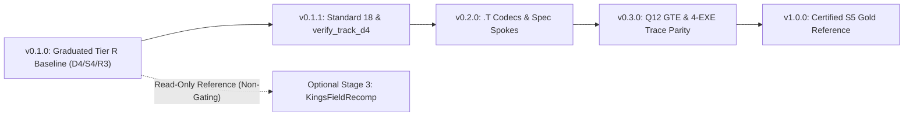

# Roadmap — KingsField-PlayStation

> **Baseline:** `v0.1.0` (`D4 / S4 / R3`) · **Active Horizon:** `v0.1.1` -> `v1.0.0` (`S5` Gold Research Container)
> **State & Links:** [`active.state`](active.state) · [`FEATURES.md`](FEATURES.md) · [`Dev/docs/plans/tasklist.md`](Dev/docs/plans/tasklist.md) · [`SPECIFICATIONS.md`](Dev/docs/SPECIFICATIONS.md)

---

## 1. North Star Goal (`v1.0.0` Summit)

Certify **`KingsField-PlayStation` (`SLUS-00158`)** as a self-contained **`S5` Gold Reference Research Container** (`s5_gold_report.json` `isPassed: true`, `unresolvedFieldCount == 0` in `spec_coverage.json`) featuring full `.T` codec decompressors, clean-room world/item/mesh/audio parsers, `150–380`-line `Dev\docs\specifications\*.md` spokes, Q12 host GTE + 4-executable trace parity in `Corpus\work\` / `--data-dir`, and a zero-gap 4-Doc Research Manual Shelf.

> **Pure Research Container Rule:** This repository is a strictly self-contained `Tier R` research container. Downstream [`KingsFieldRecomp`](../../Personal/KingsFieldRecomp/README.md) (`reStation`) consumes `Dev\schemas\` and `Dev\docs\` strictly **read-only**—nothing in this roadmap gates or blocks Stage-3 recompilation releases.

---

## 2. Active In-Dev Milestone (`v0.1.1` — Standard 18 & Standalone Verifier)

Focus: Extract standalone `verify_track_d4.py`, modularize `d4_harness\`, and standardize reports for clean, reproducible verification via `--data-dir` / `Corpus\work\`.

- [ ] **`T1` — Standard 18 Reports & Fail-Closed Corpus Paths (`🗄️ Data & Schema`, Unlocked):**
  - Align `d4_build_report.json`, `s4_verify_report.json`, `spec_coverage.json`, and manifest entries to Standard 18 (`generatedAtUtc`, `isPassed`, `unresolvedFieldCount`).
  - Keep `psx_kf_unpack.py` outputs strictly inside `--out-dir` / `Corpus\work\`, emitting structured `"status": "MISSING_CORPUS_MEDIA"` JSON on empty BYO-disc runs plus `--offline-synthetic` fixture mode.
- [ ] **`T2` — Author `verify_track_d4.py` & Modular Multi-TU `d4_harness\` (`🛠️ Build & Infra`, Unlocked):**
  - Extract verification checks out of [`build_and_verify_d4.py`](Dev/scripts/build_and_verify_d4.py) into a dedicated `Dev/scripts/verify_track_d4.py` matching sibling Tier R repos and `decomp_cli.py verify`.
  - Split `Dev/scripts/d4_harness/` into `<= 250` LOC/file C translation units discovered via Pass-2 globbing while keeping zero-warning MIPS32 + LP32 host parity builds.
- [ ] **`T3` — Verify `verify_track_d4.py` & Hardened `S4` Gate via `--data-dir` (`🧪 QA & Testing`, Blocked on `RND-T0`, `T1`, `T2`):**
  - Execute hardened `study_verifier.py` (`RND-T0`), `verify_track_d4.py`, and `decomp_cli.py verify --tier S4` cleanly via `--data-dir` / `Corpus\work\` with zero warnings.

---

## 3. Upcoming Stepping Stones (`v0.2.0` -> `v0.3.0` -> `v1.0.0`)

### `v0.2.0` — `.T` Wrapper Codec Parsers & `S5` Specification Spokes
- **`T4` — Flat `Dev/scripts/*.py` (`<= 250` LOC) Parsers (`⚙️ Core & Code`, Locked -> `[T3]`):** Decompress `.T`-wrapped entries (resolving `VAB.T` `.vh` `programs=16511` header anomalies) and parse `CD/COM/FDAT.T` (`0..7`), `ITEM.T`/`MAG.T`/dialogue tables, `.MO` morph meshes, and `VAB.T`/`SEQ` audio containers into `--out-dir` / `Corpus\work\`.
- **`T5` — Zero-Gap `Dev/docs/specifications/*.md` Spokes (`📘 Docs & DevLog`, Locked -> `[T3, T4]`):** Author `150–380`-line spec spokes linked from [`SPECIFICATIONS.md`](Dev/docs/SPECIFICATIONS.md) until `spec_coverage.json` hits `unresolvedFieldCount == 0`.

### `v0.3.0` — Q12 Host GTE & 4-Executable Chain Trace Parity
- **`T6` — Host GTE Model & 4-EXE Trace Parity (`🧪 QA & Testing`, Locked -> `[T4, T5]`):** Add deterministic Q12 host GTE (`COP2`) math (`RTPS`/`RTPT`/frustum `0x800342D8`) and verify `SLUS_001.58 -> OPEN.EXE -> GAME.EXE -> END.EXE` handoff traces across map zones (`0..7`) in `Corpus\work\` / `--data-dir`.

### `v1.0.0` — Certified `S5` Gold Reference Research Container
- **`T7` — `S5` Gold Certification Gate (`🧪 QA & Testing`, Locked -> `[T5, T6]`):** Generate `Dev/schemas/s5_gold_report.json` (`isPassed: true`, `unresolvedFieldCount == 0`) and pass `decomp_cli.py verify --tier S5` (`0` err / `0` warn).
- **`T8` — Summit Manual Shelf & Notion Sync (`📘 Docs & DevLog`, Locked -> `[T7]`):** Finalize the `S5` Gold 4-Doc Manual Shelf, Root Quartet, `active.state` (`version: "1.0.0"`), and Notion summit parity.

---

## 4. Completed Milestones

- [x] **`v0.1.0` (`2026-11-14`) — Graduated `Tier R` Repository (`D4 / S4 / R3`):** Graduated `../../Personal/R&D\decomps\ps1\kings-field` (`SLUS-00158`) into 3-folder `Tier R` storage with `12` SHA-256 baseline entries (`716.86 MB` read-only corpus), `1,757` functions (`1,632` named game + `125` PS1-SDK SDK, `0` failed), `1,549/1,549` globals, `46` structs / `21` typedefs / `3` enums, `268` readable files (`clangd 23.1.0` `0` err/warn), `260/260` ELF32 LE MIPS `.o` -> `libkings_field_d4.a` (`1,841,082` B), `10/10` LP32 host parity tests, `psx_kf_unpack.py`, and read-only `R3` reference link to [`KingsFieldRecomp`](../../Personal/KingsFieldRecomp/README.md) (`v0.1.3`).

---

## 5. Icebox & Cutting-Room Floor

- **`D5` (`1:1` Retail Byte-Matching Assembly / Codegen):** Optional per-TU PS1-SDK MIPS instruction-exact matching over `SLUS_001.58`, `OPEN.EXE`, `GAME.EXE`, and `END.EXE` into `Dev/schemas/d5_byte_match.json`. Non-blocking for `v1.0.0` `S5` Gold and downstream [`KingsFieldRecomp`](../../Personal/KingsFieldRecomp/README.md).
- **Multi-Regional Revision Differentials (`SLPS-00017` / `SLES-00201`):** Optional JP (`King's Field II` naming) / PAL comparative binary offset & container diffs.
